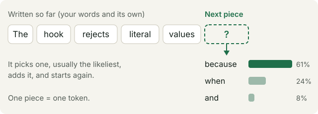
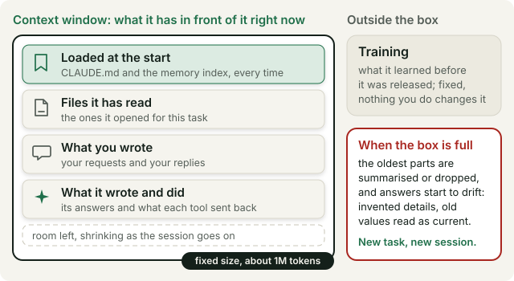
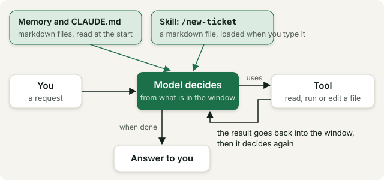
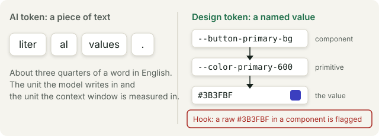

# How this actually works

A ten-minute read before Session 1, with four pictures and a glossary at the
end. There is nothing to install on this page; the install check is in your
pre-work email.

The people in this cohort start from very different places with AI. Some use
it every day and some have barely opened it. This page is written for the
second group, so that on Thursday nobody has to guess what a word means. If
you are in the first group, look at the four pictures and skim the glossary.

In Session 1 you will type an instruction to an AI, watch it edit files in a
small project, and see a rule push back on it. All of that is easier to
follow if you know four things about what is going on underneath. None of
them need a technical background, and you will hear all four words again on
the evening.

---

## 1. How models think: tokens

You have seen a small version of this on your phone: the keyboard suggests
the next word while you type. The model behind Claude Code or Codex does the
same thing, with far more text behind it. It reads everything written so far,
picks the next small piece of text, adds it, and reads again. That small piece
is called a **token**. Most tokens are a word or part of a word: "guardrail"
is two tokens, a comma is one.

Three things follow from this:

- **It writes; it does not look things up.** It is natural to picture a
  search engine behind the chat: a question goes in, a stored answer comes
  out. That is not what happens. The model writes a continuation that fits
  what came before. When the continuation is right it reads as knowledge.
  When it is wrong it reads exactly the same, with the same confidence.
  Fluent and wrong at the same time is normal for these tools, which is why
  Session 4 is about checking.
- **The way you ask shapes the answer.** The model starts from your words,
  so a clear request and a vague one lead to different answers. Tell it what
  you want, what it is for and what a good result looks like, and the reply
  lands closer to what you had in mind. There are no magic phrases to learn;
  it simply works from what you gave it.
- **Ask the same thing twice and you can get two different answers.** At
  each step there are several pieces that would fit, and the model does not
  always take the same one. For a quick chat this does not matter. For a
  project it does, so in this track the instructions that must be the same
  every time are saved in files the AI reads at the start, instead of being
  typed again in every session.

## 2. Everything it knows right now fits in one box

There are two kinds of knowledge. **Training** is what the model learned
before you ever opened it. Companies such as Anthropic and OpenAI train a
model on a very large amount of text, and when training ends the model is
released to the public as it is. Nothing you do in a session changes it.

The **context window** is everything the model has in front of it in this
session: the files it was given at the start, the files it has read since,
your messages, its own answers, and the results of what it did. That box has
a fixed size, measured in the tokens from section 1. On the current top
models one session holds up to about one million tokens, which is hundreds of
pages. It still fills.

When it fills, the oldest parts are summarised or dropped and the model works
from what is left. Working in a session that is close to full costs you
twice. The model gets slower and less precise, and the early context it lost
is replaced by guesses. Answers start to drift: details get invented, a stale
value from an old file is read as the current one, a decision from an hour
ago is forgotten. To avoid this, the project you clone in Session 1 has a
memory folder. At the end of a session the AI writes down what the next
session needs, and the next session reads it at the start.

So:

- **A session has a start and an end.** Finish one task, close the session,
  and start a new one for the next task. The longer a session runs, the less
  room it has for the task in front of it.
- **What is loaded at the start matters most.** In the starter project, the
  file called `CLAUDE.md` and the memory index are read first, every session.
  This is why teaching the AI a decision means writing the decision in a file
  rather than saying it in chat: what you said in chat is gone when the
  session closes, and what is in the file is back in the box next time.
- **Memory**, in this track, means files the AI reads at the start of a
  session and writes at the end. There is nothing more mysterious to it than
  that.

## 3. An agent is the model in a loop with tools

A chat answers. An **agent** acts: the model decides what to do next, uses a
**tool** (read this file, run this command, edit that file), the result comes
back into the context window, and it decides again, until the job is done and
it answers you. Claude Code and Codex are that loop, running in your project
folder. Everything you install in this track sits on this loop.

- **Markdown file**: a plain text file with light formatting (headings,
  lists, bold) and the extension `.md`. The instructions, the memory and the
  skills in this track are all markdown files, and you can read and edit them
  in any text editor.
- **Skill**: a saved instruction file with a name. Typing the name, for
  example `/new-ticket`, loads that file into the window and the agent follows
  it. A process you repeat becomes a skill.
- **Hook**: a small program that runs by itself when something happens, for
  example after every file edit. It can reject the edit by rules you decide to
  enforce. This is the difference between a rule written down in a markdown
  file and a rule enforced via hooks; you will see this in action in the first
  hour of Session 1.
- **Memory files and `CLAUDE.md`**: read at the start, as in section 2.
- **Agent definition** (Session 2): a file that gives the loop a role,
  constraints and reference material for one specific job. A persona line on
  its own ("you are a senior designer") barely changes the output; the
  constraints and the material do.

## 4. "Token" means two things on Thursday

If you are not a designer: there are two types of "tokens" we will talk about
on Thursday. How to not confuse them:

An **AI token** is a piece of text, as in section 1. A **design token** is a
named value in a design system, such as `--color-primary-600`, that
components point at instead of writing the colour directly.

The point of a design token is that a colour is decided in one place. If the
brand green changes, you change the token's value once and every button, link
and badge that points at it follows. Write the colour directly into fifty
components and you have fifty places to find and fix, and sooner or later one
is missed and the product stops looking like one product. In the starter
project every colour, spacing and radius goes through a token, and a hook
checks every file the AI writes and rejects a raw value such as `#85573a`.

So the word you hear at the start of the evening and the word in the hook's
rejection an hour later are different things that share a name. Nobody chose
this; both fields got there first.

---

## Glossary

Three short lists of the terms you will hear during the four evenings. Each
list is written for the people who do not already use those words, so skip
the one you live in.

### From the AI side

- **Model**: the program that predicts the next token. Claude is a family of
  models made by Anthropic and GPT is OpenAI's; Claude Code and Codex are the
  tools that put one of those models in the loop from section 3.
- **Prompt**: whatever you write to the model. In this track the saved files
  count as prompt too; the difference is that they are written once and
  loaded every time.
- **Token**: a piece of text, about three quarters of a word. It is the unit
  the model writes in and the unit the context window is measured in.
- **Context window**: everything the model has in front of it right now, in
  this session. It has a fixed size and it fills up as the session goes on.
- **Session**: one context window, from the moment you open it to the moment
  you close it. In the starter project, typing "Session done." is the close:
  it writes the memory files for the next session.
- **Agent**: a model set up to act as well as answer. It decides, uses a tool,
  reads the result and decides again until the job is done. Claude Code and
  Codex are agents.
- **Tool**: an action the agent can take on your behalf: read a file, edit a
  file, run a command, search the web.
- **Skill**: a saved instruction file with a name, run by typing that name
  (`/new-ticket`, `/critique`, `/session-2`).
- **Hook**: a small program that runs by itself when something happens, for
  example after every file edit, and can reject the result.
- **Memory**: the files the agent reads at the start of a session and writes
  at the end (`CLAUDE.md` and the `memory/` folder).
- **`CLAUDE.md`**: the one file the project always loads first. It holds the
  brief, the decisions, the rules and the session protocol.
- **Hallucination**: a fluent answer that is wrong, stated with the same
  confidence as a right one.
- **Terminal**: the text window where you type commands instead of clicking.
  Claude Code and Codex run there.
- **Repo, clone, commit**: a repo is a project folder together with its full
  history of changes; cloning copies it to your machine; a commit is a saved
  snapshot with a short message saying what changed. The install script
  checks that you have what you need.

### From the delivery side (if you are a designer)

- **Ticket**: one unit of work, written down before it starts. Every exercise
  in this track is a ticket (`BRW-101` to `BRW-105`).
- **Story**: the ticket's purpose in one sentence: "As a [who], I want
  [what], so that [why]."
- **Acceptance criteria**: the checklist that defines done, written before the
  work starts. The agent is held to it, and so are you.
- **Spec**: what to build, decided before building starts. Session 3 works
  spec first.
- **Definition of done**: the acceptance criteria met, and nothing invented
  along the way.

### From the design side (if you are not a designer)

- **Design system**: the shared set of components, tokens and rules a product
  is built from, so that ten screens look like one product.
- **Design token**: a named value (`--color-primary-600`, `--space-4`) that
  components point at instead of a raw value. The starter project has three
  layers: primitives, component tokens, components.
- **Component**: a reusable piece of interface with its own rules: Button,
  Input, Badge, Card.
- **Variant**: a deliberate version of a component: primary, secondary,
  ghost.
- **State**: how a component looks in a given situation: hover, focus,
  disabled, error.
- **Component story**: a short spec for a component, written before the
  component exists. In the starter project it is a markdown file in the
  design system's `stories/` folder.
- **Accessibility**: usable by everyone, including people who work with a
  keyboard or a screen reader. Contrast is the part you can measure: text
  needs at least 4.5:1 against its background.

---

## Three links to keep

Every project in this track runs as a git repo, and so should every AI
project you start afterwards. If git is new to you, start with the first
link; the other two are there when you want the longer story.

| | | |
|---|---|---|
|  |  |  |
| **Git for designers**, a seven-minute guide [claudefordesigners.com/guide/git-basics](https://claudefordesigners.com/guide/git-basics) | **GitHub**, where the repos live [github.com](https://github.com) | **Git**, the background [en.wikipedia.org/wiki/Git](https://en.wikipedia.org/wiki/Git) |

---

## Before Thursday

Do the install check from your pre-work email, run the opening line once
("Read CLAUDE.md, then give me the state of the project in three
sentences"), and send the three sentences back. If anything on this page did
not land, bring the question; the opening block of Session 1 is these four
pictures, live.
